<div align="center">




<p>
  <a href="mailto:deepsiddhant03@gmail.com"></a>
  <a href="https://linkedin.com/in/siddhant-deep"></a>
  <a href="https://github.com/TechSidd18"></a>
</p>


</div>

---

### ⚡ ABOUT ME

```yaml
Name: Siddhant Deep
Role: Data Analyst & Creative Designer
Focus: SQL (PostgreSQL), Power BI, MS Excel Modeling, Python EDA
Community: Codester Club (Creative Head)
```

- 🔭 Currently architecting **data analysis pipelines, PostgreSQL databases & Power BI KPI dashboards**.
- 📊 Hands-on with **exploratory data analysis (EDA), statistical modeling, and data storytelling**.
- 💡 **Creative Head @ Codester Club** — leading visual direction, tech culture, and event design.

---

### 🛠️ TECH STACK &amp; ARSENAL

<div align="center">



</div>

---

### 📂 FEATURED PROJECTS

<table>
<tr>
<td width="50%" valign="top">

#### 📈 [EMI Stress Test: Borrowing Risk Analysis](https://github.com/TechSidd18)
*FinTech Credit Risk &amp; Default Analytics*

- Analyzed loan portfolio datasets in **PostgreSQL** to assess if elevated EMI-to-income ratios directly trigger loan defaults.
- Implemented **CTEs, Window Functions, CASE WHEN, and multi-table JOINs** to segment borrower risk cohorts.
- Built **Power BI KPI dashboards** visualizing debt-burden thresholds and delinquency indicators.

<br/>


</td>
<td width="50%" valign="top">

#### 🎟️ [College Event Registration &amp; RSVP Portal](https://github.com/TechSidd18)
*Full-Stack Event Management &amp; Analytics*

- Full-stack RSVP platform replacing spreadsheets across **13+ college tech events**.
- Relational schema, auto-generated REST APIs, and auth powered by **Supabase (PostgreSQL)**.
- **Node.js** registration backend with a live administrative headcount monitoring dashboard.

<br/>


</td>
</tr>
<tr>
<td width="50%" valign="top">

#### 📊 [Study vs Distraction Analysis](https://github.com/TechSidd18)
*Behavioral Data Science &amp; Statistical EDA*

- Analyzed survey datasets from **27 students** to quantify how smartphone notifications and interruptions affect continuous study focus.
- Performed **Exploratory Data Analysis (EDA)** and correlation modeling in **Python (Pandas, Seaborn)** to map concentration drop-off points.

<br/>


</td>
<td width="50%" valign="top">

#### 🏏 [Virat Kohli Web Experience](https://github.com/TechSidd18/VIRATKOHLI)
*Responsive Front-End Showcase*

- Interactive tribute landing page featuring responsive grid architecture and fluid CSS micro-animations.
- Built with **HTML5, CSS3, JavaScript, and Bootstrap**.

<br/>


</td>
</tr>
</table>

---


### 💻 CODE MODE

<div align="center">



</div>

---

### 🔄 DATA PIPELINE

<div align="center">



</div>

---

### 🎮 GAME MODE

<div align="center">

<!--G2K_BOARD:START--><!--G2K_BOARD:END-->

<a href="https://github.com/TechSidd18/TechSidd18/issues/new?title=g2k%7Cleft&body=Just+press+%22Submit+new+issue%22.+Do+not+edit+the+title."></a>
<a href="https://github.com/TechSidd18/TechSidd18/issues/new?title=g2k%7Cup&body=Just+press+%22Submit+new+issue%22.+Do+not+edit+the+title."></a>
<a href="https://github.com/TechSidd18/TechSidd18/issues/new?title=g2k%7Cdown&body=Just+press+%22Submit+new+issue%22.+Do+not+edit+the+title."></a>
<a href="https://github.com/TechSidd18/TechSidd18/issues/new?title=g2k%7Cright&body=Just+press+%22Submit+new+issue%22.+Do+not+edit+the+title."></a>

</div>

**How to play:** 2048, but every visitor plays the same board together. Click a direction, then press **Submit new issue** (don't edit the title). A GitHub Action slides the tiles, adds a new one and refreshes the board in a minute or two. Merge equal tiles and try to reach **2048**.

**Recent moves**

<!--G2K_LOG:START-->
- `@TechSidd18` moved **left** (+0)
<!--G2K_LOG:END-->

---

### 📊 ACTIVITY &amp; STATS

<div align="center">











</div>

#### 🛰️ RECENT ACTIVITY

<!--RECENT_ACTIVITY:START-->
- Pushed 1 commit to [TechSidd18/TechSidd18](https://github.com/TechSidd18/TechSidd18) &nbsp;<sub>`2d ago`</sub>
- Pushed 1 commit to [TechSidd18/TechSidd18](https://github.com/TechSidd18/TechSidd18) &nbsp;<sub>`3d ago`</sub>
- Pushed 1 commit to [TechSidd18/TechSidd18](https://github.com/TechSidd18/TechSidd18) &nbsp;<sub>`2d ago`</sub>
- Opened an issue in [TechSidd18/TechSidd18](https://github.com/TechSidd18/TechSidd18) &nbsp;<sub>`3d ago`</sub>
- Pushed 1 commit to [TechSidd18/TechSidd18](https://github.com/TechSidd18/TechSidd18) &nbsp;<sub>`6d ago`</sub>
- Pushed 1 commit to [TechSidd18/TechSidd18](https://github.com/TechSidd18/TechSidd18) &nbsp;<sub>`7d ago`</sub>
<!--RECENT_ACTIVITY:END-->

---

### 📬 CONNECT WITH ME

<div align="center">

<a href="mailto:deepsiddhant03@gmail.com"></a>
<a href="https://linkedin.com/in/siddhant-deep"></a>
<a href="https://github.com/TechSidd18"></a>

<br/><br/>


</div>
